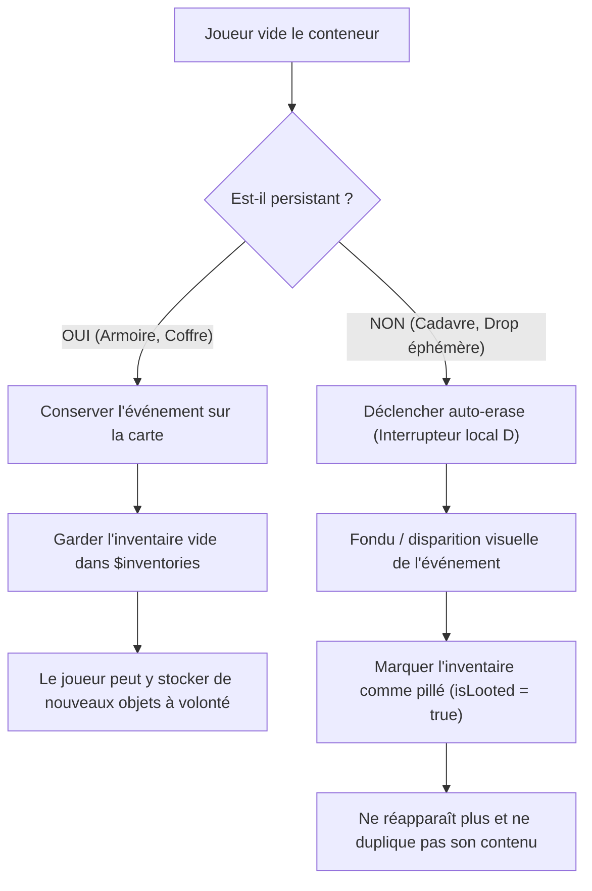

# 🎒 TUTORIEL DÉVELOPPEUR : MULTI-INVENTAIRES & CONTENEURS

Le système de **Multi-Inventaires** de SimCraft 4 permet de gérer des inventaires secondaires totalement autonomes et indépendants de l'inventaire principal de l'équipe (`$gameParty`) :
- **Inventaires d'acteurs** (`A_[ID]`) : Sacs à dos individuels pour les compagnons et héros.
- **Conteneurs de carte** (`C_[ID]`) : Armoires, coffres de rangement, boîtes de stockage ou caisses de ravitaillement.
- **Butins d'ennemis** (`E_[ID]`) : Inventaires de cadavres d'ennemis générés dynamiquement selon leurs tables de drop vanilla.

---

## ⚔️ 1. Objets, Armes et Armures

> [!IMPORTANT]
> **Les inventaires secondaires supportent nativement et sans restriction les trois types d'équipements de RPG Maker MZ :**
> 1. **Objets consommables** (`$dataItems`)
> 2. **Armes** (`$dataWeapons`)
> 3. **Armures** (`$dataArmors`)

Tous ces types sont affichés dans l'interface de transfert [Scene_Inventory](file:///c:/SERVER/htdocs/SimCraft/SC4/js/plugins/Scene_Inventory.js), s'échangent d'un simple clic avec l'inventaire du joueur, et sont entièrement sérialisés lors de la sauvegarde.

---

## 🗄️ 2. Fichier de Configuration Initial : `data/SC/INVENTORIES.json`

Au démarrage d'une nouvelle partie, le fichier [data/SC/INVENTORIES.json](file:///c:/SERVER/htdocs/SimCraft/SC4/data/SC/INVENTORIES.json) pré-remplit les inventaires désignés.

Vous pouvez y inscrire des objets, des armes ou des armures selon la syntaxe de votre choix :

```json
{
  "A_1": [
    { "item_id": 7, "quantity": 10 },
    { "weapon_id": 1, "quantity": 1 }
  ],
  "C_1": [
    { "item_id": 7, "quantity": 5 },
    { "weapon_id": 2, "quantity": 1 },
    { "armor_id": 1, "quantity": 1 }
  ],
  "E_1": [
    { "item_id": 7, "quantity": 2 }
  ]
}
```

### Formats d'entrées acceptés dans le JSON :
| Type | Syntaxe Recommandée | Syntaxes Alternatives |
| :--- | :--- | :--- |
| **Objet** | `{"item_id": 7, "quantity": 10}` | `{"id": 7, "quantity": 10}` ou `{"kind": 1, "item_id": 7}` |
| **Arme** | `{"weapon_id": 1, "quantity": 1}` | `{"kind": 2, "item_id": 1}` ou `{"type": "weapon", "id": 1}` |
| **Armure** | `{"armor_id": 1, "quantity": 1}` | `{"kind": 3, "item_id": 1}` ou `{"type": "armor", "id": 1}` |

---

## 📦 3. Conteneurs Persistants vs Conteneurs Éphémères (Auto-Erase)

Le moteur distingue deux comportements fondamentaux lors du vidage complet d'un conteneur :



### A. Conteneurs Persistants (Armoires, Coffres de base, Stockage)
- **Objectif** : Un meuble ou un coffre fixe où le joueur stocke ses équipements.
- **Comportement** :
  - Ne s'efface **JAMAIS** de la carte, même lorsqu'il est complètement vide.
  - Le joueur peut y déposer des armes/objets depuis son inventaire, les reprendre plus tard, vider le meuble et le remplir à nouveau.
  - Sauvegardé fidèlement dans les fichiers de sauvegarde.
- **Configuration** :
  - **Notetag dans l'événement** : `<inventory: C_1, persistent>` ou `<persistent>`.
  - **Par script** : `$inventories.open('C_1', { eventId: 5, persistent: true })`.

### B. Conteneurs Éphémères / Auto-Erase (Cadavres d'ennemis, Caisses de butin uniques)
- **Objectif** : Un sac au sol, un cadavre d'ennemi abattu ou une caisse à usage unique.
- **Comportement** :
  - Dès que le joueur prend le dernier objet :
    1. L'interrupteur local `D` de l'événement est activé (permettant d'activer une page D de disparition ou de respawn).
    2. L'événement subit une disparition visuelle immédiate (`setOpacity(0)` et `ev.erase()`).
    3. L'inventaire est retiré du registre actif et enregistré comme pillé (`$inventories.isLooted(id) === true`).
- **Configuration** :
  - Automatique pour les butins d'ennemis (`E_[ID]`).
  - Pour un conteneur éphémère : notetag `<auto_erase>` ou `<inventory: C_1, auto_erase>`.

---

## 💾 4. Persistance Sauvegarde & Chargement (Save / Load)

La persistance des inventaires est orchestrée par [SC_DataManager.js](file:///c:/SERVER/htdocs/SimCraft/SC4/js/plugins/SC_DataManager.js) sans modifier le code natif de RPG Maker MZ :

1. **Sauvegarde de la partie (`DataManager.makeSaveContents`)** :
   - Tous les inventaires actifs sont sérialisés (`$inventories.makeSavefileData()`).
   - Le statut des conteneurs persistants (remplis ou vides) et la liste des butins déjà pillés (`_looted`) sont enregistrés dans le fichier de sauvegarde (`saveX.rmmzsave`).
2. **Chargement de la partie (`DataManager.extractSaveContents`)** :
   - Les inventaires sont reconstitués à l'identique (`$inventories.loadSavefileData()`).
   - **Protection contre la duplication de loot** : Si une armoire `C_1` ou un ennemi `E_1` a été vidé avant la sauvegarde, son état vide ou pillé est préservé. Le moteur ne recharge **JAMAIS** les données initiales de `INVENTORIES.json` pour un inventaire déjà géré.

---

## 🗺️ 5. Configuration d'un Événement dans l'Éditeur

### Exemple 1 : Armoire Personnelle Persistante (Ex: Map 31, Event 5)

Dans la fenêtre de l'événement RPG Maker MZ :
- **Note de l'événement** (ou en commentaire `108` sur la page) :
  ```text
  <inventory: C_1, persistent>
  ```
- **Contenu de la page (Appel de script)** :
  ```javascript
  $inventories.open('C_1', { eventId: this.eventId(), persistent: true });
  ```
  *(Ou simplement : `this.openInventory('C_1', true);`)*

### Exemple 2 : Caisse de ravitaillement éphémère (Auto-Erase une fois vidée)

- **Note de l'événement** :
  ```text
  <inventory: C_2, auto_erase>
  ```
- **Page 1 (Appel de script)** :
  ```javascript
  this.openInventory('C_2', false);
  ```
- **Page 2 (Condition : Interrupteur local D)** :
  - Page vide ou animation de disparition / commande « Effacer l'événement ».

### Exemple 3 : Cadavre d'ennemi (Butin vanilla + probabilités)

- **Page de mort de l'ennemi (Condition : Interrupteur local C)** :
  ```javascript
  $inventories.initEnnemyInventory(1); // Ennemi ID 1
  this.openEnemyLoot(1);
  ```
  *(Dès que le joueur transfère tous les objets dans son sac, la scène active l'interrupteur local D et efface le cadavre).*

---

## 🛠️ 6. API Scriptable Développeur

| Méthode | Description |
| :--- | :--- |
| `$inventories.create(id, options)` | Crée ou réinitialise un inventaire avec restrictions et options complètes. |
| `$inventories.remove(id)` | Supprime un inventaire du registre actif (alias simple de unset). |
| `$inventories.inventory(id)` | Récupère ou instancie l'inventaire `Game_Inventory` désigné. |
| `$inventories.open(id, options)` | Ouvre l'interface de transfert [Scene_Inventory](file:///c:/SERVER/htdocs/SimCraft/SC4/js/plugins/Scene_Inventory.js) avec options `{ eventId, persistent }`. |
| `$inventories.initEnnemyInventory(enemyId)` | Génère le butin unique d'un ennemi selon ses probabilités de drop et `INVENTORIES.json`. |
| `$inventories.setPersistent(id, true/false)` | Définit dynamiquement si un inventaire est persistant ou auto-erase. |
| `$inventories.updateEventSelfSwitchB(containerId)` | Active automatiquement l'interrupteur local B si le conteneur est vide, ou le désactive s'il contient des objets. |
| `$inventories.isLooted(id)` | Vérifie si un inventaire a déjà été vidé et pillé. |
| `$inventories.unset(id)` | Supprime un inventaire du registre actif. |
| `this.openInventory(id, persistent)` | Raccourci utilisable directement dans une commande d'événement RMMZ. |
| `this.openEnemyLoot(enemyId)` | Raccourci pour initialiser et ouvrir le butin d'un cadavre d'ennemi. |

---

## 🔒 7. Restrictions d'Usage des Conteneurs (`INVENTORIES.json`)

Les conteneurs de carte (`C_[ID]`) peuvent être restreints dans [data/SC/INVENTORIES.json](file:///c:/SERVER/htdocs/SimCraft/SC4/data/SC/INVENTORIES.json) :

```json
{
  "C_ARMORY": {
    "persistent": true,
    "onlyWeapons": true,
    "maxSlots": 5,
    "maxWeight": 40,
    "items": [
      { "weapon_id": 1, "quantity": 2 }
    ]
  },
  "C_AMMO_BOX": {
    "persistent": true,
    "onlyAmmo": true,
    "maxSlots": 3,
    "items": []
  },
  "C_RESTRICTED": {
    "persistent": true,
    "allowedItemIds": [7, 8, 10],
    "blockedItemIds": [13],
    "maxSlots": 3,
    "items": []
  }
}
```

### Paramètres de restriction disponibles :
| Paramètre | Type | Effet |
| :--- | :--- | :--- |
| `persistent` | `boolean` | `true` = meuble fixe / stockage, `false` = éphémère. |
| `auto_erase` | `boolean` | Si `true`, active l'interrupteur D et disparaît une fois vidé. |
| `onlyWeapons` | `boolean` | N'accepte que les armes (`$dataWeapons`). |
| `onlyItems` | `boolean` | N'accepte que les consommables (`$dataItems`). |
| `onlyArmors` | `boolean` | N'accepte que les armures / accessoires (`$dataArmors`). |
| `onlyAmmo` | `boolean` | N'accepte que les munitions (notetag `<ammo>` ou assignées à une arme via `<ammoId>`). |
| `allowedTypes` | `Array<string>` | Liste des types autorisés (ex: `["weapon", "ammo"]`). |
| `allowedItemIds` | `Array<number>` | Liste stricte des ID d'objets autorisés. |
| `blockedItemIds` | `Array<number>` | Liste des ID d'objets interdits. |
| `maxSlots` | `number` | Nombre maximum d'emplacements (types d'objets distincts). |
| `maxWeight` | `number` | Poids cumulé maximal toléré dans le conteneur. |

---

## ⚖️ 8. Système de Poids, Capacité et Surcharge

### A. Notetags de Poids des Objets
Par défaut, chaque objet, arme ou armure pèse **1 kg** (ou 1 unité). Des notetags permettent de personnaliser cette valeur :
```text
<height:[VALUE]>
ou
<weight:[VALUE]>
```
*Exemples :*
- `<height: 0.5>` : Potion légère (0.5 kg).
- `<weight: 5>` : Épée lourde (5 kg).
- `<weight: -15>` : Sac à dos tactique ou brelage (gain de place / bonus de capacité).

> [!IMPORTANT]
> **Équipements à poids négatif (Sacs à dos, Harnais tactiques)** :
> - Lorsqu'un acteur équipe cet objet, sa capacité de transport augmente du montant correspondant (+15 kg).
> - S'il retire l'équipement, le bonus de capacité disparaît immédiatement.
> - Dans le sac du joueur (non porté), l'objet a un poids physique plancher de 0 kg (il ne peut pas rendre le sac plus léger s'il n'est pas enfilé).
> - **L'équipement porté n'est pas comptabilisé dans le poids du sac.**

### B. Calcul de la Capacité en Poids de l'Équipe
1. **Capacité d'un acteur** :
   $$\text{Capacité} = \max(10, \text{Math.round}(\text{atk} \times 2.5)) + \text{Bonus équipement}$$
2. **Capacité globale du groupe (`$gameParty.maxWeight()`)** :
   Somme des capacités de tous les membres actifs du groupe. Lorsqu'un nouvel allié rejoint l'équipe, la force et la capacité s'ajustent automatiquement.

### C. État de Surcharge (Overload)
- **Détection** : Si le poids total accumulé dépasse la capacité maximale (`$gameParty.totalWeight() > $gameParty.maxWeight()`).
- **Conséquences** :
  1. Le joueur **ne peut plus se déplacer** (`$gamePlayer.canMove() === false`).
  2. Chaque tentative de déplacement déclenche un **buzzer d'avertissement** et fait **flasher le sprite du personnage en rouge** vif.
  3. Le transfert d'objets qui causerait une surcharge supplémentaire est bloqué avec un avertissement sonore.

### D. Option pour Jeter des Objets (Drop)
Pour se décharger rapidement d'un excédent de poids :
- **Dans la scène de transfert ([Scene_Inventory](file:///c:/SERVER/htdocs/SimCraft/SC4/js/plugins/Scene_Inventory.js))** :
  En sélectionnant un objet dans son sac, le joueur a accès à **« Jeter 1 »** et **« Jeter Tout »**.
- **Dans l'inventaire personnel ([Scene_Item](file:///c:/SERVER/htdocs/SimCraft/SC4/js/plugins/SC4_rmmz_scenes_Patches.js))** :
  En validant un objet, une fenêtre propose **« Utiliser »**, **« Jeter 1 »**, **« Jeter Tout »** ou **« Annuler »**. Jeter un objet allège immédiatement le sac et rétablit la mobilité.

---

## 🖥️ 9. Interface Utilisateur Repensée & Localisation

### A. Scène de Transfert (`Scene_Inventory`)
1. **Barre de commande supérieure (au-dessus de la description et des listes)** :
   - **« Prendre »** : Active la liste du conteneur (Prendre 1, Prendre Tout).
   - **« Déposer »** : Active la liste du sac personnel (Déposer 1, Déposer Tout). *Désactivé automatiquement si le conteneur est un cadavre d'ennemi ou éphémère.*
   - **« Fermer »** : Quitte la scène.
2. **Pied de liste avec suivi du poids** :
   Chaque liste affiche en temps réel : `Poids: [accumulé]/[capacité]` (ex: `Poids: 14/50`).
   Si la limite est dépassée, le texte s'affiche en **rouge d'alerte**.

### B. Interrupteur Local B Automatique (Conteneurs)
Pour tout événement portant le tag `<inventory: C_[id]>` :
- Si le conteneur devient vide, l'interrupteur local **B** de l'événement passe automatiquement à `true`.
- Dès qu'un objet y est re-déposé, l'interrupteur local **B** repasse à `false`.

### C. Localisation Multi-Langue
Toutes les chaînes de texte (`inventory.take`, `inventory.deposit`, `inventory.drop_one`, `inventory.drop_all`, `inventory.weight`, etc.) sont connectées aux dictionnaires dynamiques [Localisation_FR.json](file:///c:/SERVER/htdocs/SimCraft/SC4/data/SC/Localisation_FR.json) et [Localisation_EN.json](file:///c:/SERVER/htdocs/SimCraft/SC4/data/SC/Localisation_EN.json).

---

## 🧪 10. Validation par les Tests Unitaires

La suite de tests unitaires complète de l'Étape 10 valide l'ensemble des fonctionnalités :

```bash
node UNIT_TESTS/test_step10.js
```
*(16 tests exhaustifs validant l'instanciation, les restrictions de conteneurs, l'API simple, les notetags de poids, le bonus négatif d'équipement, la force d'équipe, le blocage de surcharge, l'alerte rouge, l'action drop, l'interrupteur local B et les règles de dépôt).*

